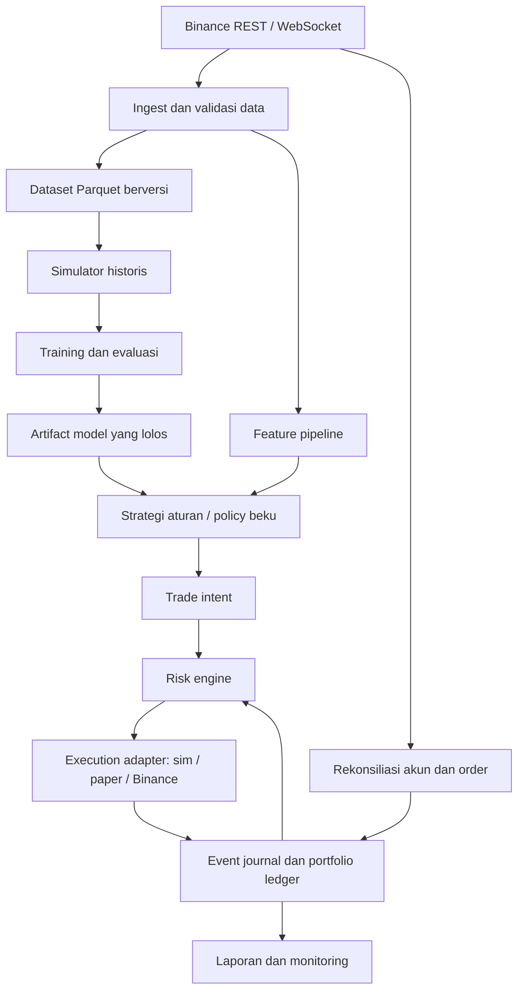

# Arsitektur Tradebot

Status: arsitektur v0.1 untuk implementasi, 10 November 2026. Kontrak numerik ada di [experiment-spec.md](experiment-spec.md), gate di [acceptance.md](acceptance.md), operasi di [operations.md](operations.md). Belum ada runtime, model terlatih, atau validasi profitabilitas. Keputusan produk dan status persetujuan ada di [decisions.md](decisions.md).

## Tujuan dan batas sistem

Service Binance Futures yang dapat terus berjalan, memutuskan long/short atau menunggu, menerapkan TP/SL, dan menghasilkan laporan yang dapat ditelusuri. Fokus pertama adalah simulator dan evaluasi; live trading adalah fase terpisah.

Konfigurasi eksperimen yang disepakati: modal sekitar USD 100, BTCUSDT perpetual USDⓈ-M dengan margin USDT, isolated margin, leverage maksimal 5x, risiko awal 0,5% per transaksi termasuk cadangan biaya/slippage, batas rugi harian 5%, keputusan pada penutupan candle 15 menit, konteks candle 1 jam yang telah selesai.

## Bentuk aplikasi dan stack

Gunakan modular monolith Python: satu repository dan satu paket domain, dengan entry point terpisah untuk ingest, backtest, train, evaluate, dan paper trading. Tidak perlu microservices untuk skala awal. Ini pilihan teknis awal untuk implementasi lokal, bukan bukti stack telah diuji.

- Python 3.11 sebagai target; versi dependensi exact dikunci resolver dan diuji saat bootstrap sesuai kontrak operasi.
- NumPy/pandas untuk pengolahan data; Parquet untuk dataset immutable yang berversi.
- Gymnasium untuk kontrak simulator; Stable-Baselines3/PyTorch dengan PPO untuk eksperimen RL v0.1.
- SQLite untuk event, state, dan jurnal pada proses paper/live tunggal. Migrasi PostgreSQL hanya bila kebutuhan concurrency mengharuskannya.
- REST dan WebSocket Binance di belakang adapter; schema dan endpoint diverifikasi terhadap dokumentasi terbaru sebelum implementasi.
- CLI dan laporan JSON/CSV/HTML lokal sebagai antarmuka v0.1. Runtime unattended menargetkan Linux/systemd; kanal eksternal dan provisioning menjadi gate operasi sesuai operations.md.

## Aliran sistem

Simulator memakai domain ledger, risiko, biaya, dan intent yang sama dengan paper/live sejauh memungkinkan. Training berinteraksi dengan simulator; tidak terhubung ke endpoint order live.

## Modul dan kontrak

| Modul | Tanggung jawab | Output utama |
|---|---|---|
| `config` | Mode, parameter risiko, versi konfigurasi; tolak nilai tidak valid | Konfigurasi tervalidasi |
| `market_data` | REST backfill, stream, deteksi gap, timestamp sumber dan penerimaan | Event pasar dan dataset |
| `features` | Transformasi yang sama untuk training/inference; hanya data tersedia | Observation dengan versi schema |
| `portfolio` | Saldo, margin, posisi, PnL, fee, funding, arus dana | Snapshot equity dan eksposur |
| `strategies` | Baseline aturan dan policy RL beku | Intent dengan alasan/model ID |
| `risk` | Sizing, sisa budget harian, leverage, likuiditas, filter order | Rencana order atau penolakan beralasan |
| `execution` | Adapter simulator, paper, dan Binance; idempotensi, proteksi | Event order/fill/protection |
| `reconciliation` | Cocokkan posisi, saldo, order dan proteksi dengan exchange | State konsisten atau halt |
| `simulation` | Clock historis, fill, funding, margin dan likuidasi | Episode dan ledger |
| `learning` | Training, artifact, pemilihan model, evaluasi | Policy dan laporan eksperimen |
| `reporting` | Hasil net, drawdown, biaya, pelanggaran, kesehatan service | Ringkasan harian dan audit |

Nama modul merupakan rencana struktur `src/tradebot/`, belum file yang sudah dibuat. Intent menyatakan tindakan yang diminta; risk engine menentukan ukuran dan kelayakan. Policy tidak mengirim order sendiri.

## Model keputusan dan proteksi

- Tindakan awal: wait, open long, open short, hold, close. Batasi sesuai state; tidak membalik arah melalui order yang tanpa sengaja menambah posisi.
- Satu posisi aktif ditetapkan sebagai default development v0.1. Awalnya TP/SL berbasis volatilitas dengan parameter eksplisit dan dibekukan per entry. SL tidak dijauhkan saat rugi.
- Estimasi probabilitas profit, jika ditambahkan, adalah komponen terkalibrasi terpisah. Sebelum itu gunakan risiko awal tetap dengan penolakan transaksi bila tidak layak; jangan adaptasi risiko berdasarkan confidence policy.
- Ukuran dihitung dari budget kerugian, jarak SL, biaya, slippage, serta funding yang relevan. Kuantitas dibulatkan ke bawah lalu divalidasi lagi. Minimum order tidak boleh memaksa risiko naik.
- Pilih leverage sesuai kebutuhan margin dan jarak likuidasi, tidak melebihi 5x. Batas margin 25% basis equity dan auto-add margin mati ditetapkan sebagai default development v0.1, bukan perubahan batas risiko pengguna.
- Acuan rugi harian: equity awal hari terhadap equity kini, disesuaikan arus dana, termasuk unrealized PnL, fee, dan funding. Hari dimulai 00.00 UTC, basis risiko min(equity awal, equity kini), dan limit memicu cancel entry serta close reduce-only sesuai kontrak eksperimen. Arus dana selama run v0.1 memicu halt/rebase tercatat.
- Laba intrahari tidak menaikkan batas rugi dari baseline awal hari. Budget, baseline, dan status halt disimpan agar restart tidak meresetnya.
- Risiko dipantau lebih sering daripada keputusan candle. TP/SL di exchange diverifikasi setelah fill; tangani partial fill dan order proteksi tersisa. Jika proteksi gagal, hentikan entry dan jalankan kebijakan darurat yang ditetapkan sebelum paper/live.

## State dan kegagalan eksekusi

Lifecycle service: `STARTING → RECONCILING → READY`; data kedaluwarsa, ketidakpastian akun, atau kegagalan proteksi memicu `HALTED`. Pemulihan memerlukan rekonsiliasi, bukan sekadar restart. Restart tidak boleh membuka posisi baru sebelum state pasti.

Lifecycle order mencakup planned, submitting, acknowledged, partially filled, filled, cancel pending, canceled, rejected, dan unknown. Timeout saat submit menjadi unknown; query dengan client order ID sebelum retry. Jangan menjanjikan exactly-once pada jaringan; gunakan ID stabil, deduplikasi event, jurnal persisten, dan rekonsiliasi.

Simpan intent sebelum submit. Jika proses mati antara request dan pencatatan respons, lanjutkan dengan query exchange. State posisi mencakup flat, opening, open/protected, closing, dan uncertain. Ketika uncertain, hentikan entry dan periksa exchange; order proteksi tetap harus dipantau.

WebSocket reconnect harus diikuti REST recovery untuk event yang terlewat. Heartbeat, clock skew, gap data, rate limit, saldo margin, status proteksi, dan kegagalan persistensi menjadi sinyal kesehatan.

## Penyimpanan dan reproducibility

- Dataset: simbol, timestamp UTC, waktu data tersedia, OHLCV, sumber, checksum, gap, dan versi schema. Funding/mark price ditambahkan sesuai kebutuhan simulasi; histori order book tidak diasumsikan tersedia.
- Jurnal append-only secara logis: event ID, sumber, event time, received time, run ID, intent/order/fill ID. Projection saldo dan posisi dapat dibangun ulang; sertakan snapshot dan migrasi schema.
- Artifact eksperimen: versi kode bila tersedia, manifest data/hash, konfigurasi, seed, feature schema, scaler yang dilatih hanya pada training, model, metrik, dan periode pembagian data.
- Direktori runtime yang direncanakan: `data/`, `artifacts/`, `runs/`; bukan lokasi menyimpan secret dan bukan file besar untuk commit default.
- Backup database konsisten dan latihan restore diperlukan sebelum live. Retensi dan target deployment mengikuti operations.md; provisioning belum dilakukan.

## Validasi simulator dan model

Pisahkan train, validation, dan final test secara kronologis. Beri gap/purging untuk episode atau label tumpang tindih. Jangan mengoptimasi pada final test. Test akhir yang sudah dipakai memilih model dianggap data pengembangan pada iterasi berikutnya; sediakan periode holdout baru.

Eksekusi terjadi setelah sinyal tersedia. Gunakan data lebih rinci atau asumsi konservatif saat urutan TP/SL dalam satu candle ambigu. Simulator harus memperhitungkan fee, spread/slippage, funding, filter order, margin, mark price dan likuidasi; candle saja tidak membuktikan kualitas fill live.

Bandingkan baseline dan RL dengan aturan biaya/risiko sama, beberapa seed dan periode pasar. Laporkan hasil net, drawdown, turnover, eksposur, penolakan minimum order, pelanggaran risiko, serta sensitivitas terhadap biaya. Ambang numerik dan durasi paper ditetapkan di acceptance.md sebelum run evaluasi.

Tes prioritas: aritmetika long/short dan ledger, funding, sizing dan rounding, batas harian setelah restart/arus dana, unknown order tanpa duplikasi, partial fill/proteksi gagal, dan no-lookahead. Training sukses tidak membuktikan profitabilitas.

## Mode dan operasi

- Backtest/train: lokal, data historis, tanpa kredensial order.
- Paper: data langsung, eksekusi simulasi, model beku; tidak mengirim order exchange.
- Demo/test: uji integrasi order dan recovery di lingkungan Binance yang diverifikasi; aturan bisa berbeda dari live.
- Live: dinonaktifkan secara default; butuh otorisasi eksplisit, akun yang sesuai, konfigurasi tervalidasi, dan kriteria kelulusan yang terpenuhi.

Key runtime berasal dari secret store/environment, tidak masuk log. Batasi izin sesuai kebutuhan, tanpa penarikan. Adapter menyamarkan identifier sensitif. Fase awal tidak membutuhkan key live.

## Batas penyelesaian definisi

Formula/parameter eksperimen, split data, reward, gate, recovery, retensi dan target operasi telah ditetapkan dalam dokumen acuan v0.1. Implementasi dan bukti pengujian belum tersedia. Verifikasi filter/fee/bracket live, kompatibilitas dependensi dan kualitas data adalah pekerjaan validasi nyata, bukan nilai yang boleh dikarang untuk menutup definisi. Budget/provider/kanal eksternal dipilih bersama pengguna sebelum provisioning atau aktivasi live; simulator tidak bergantung pada keputusan pembelian tersebut.
